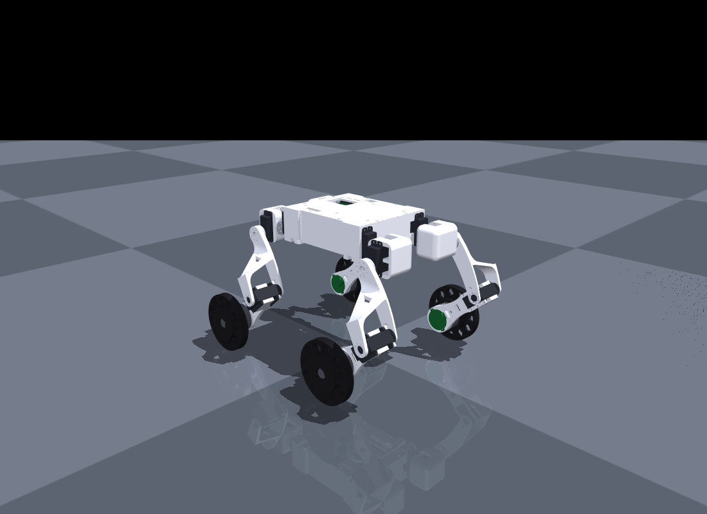
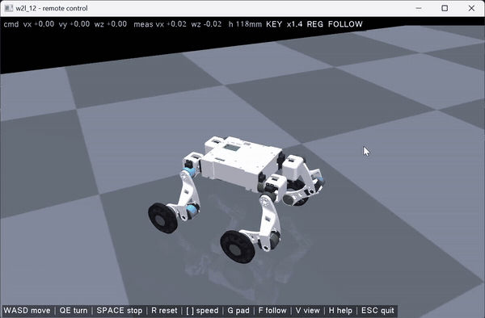
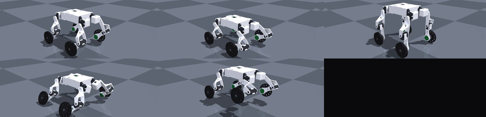
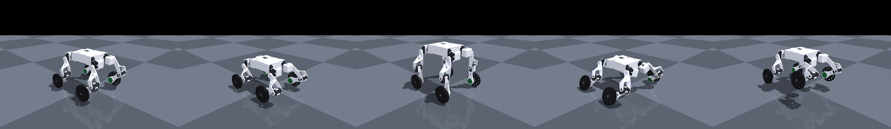
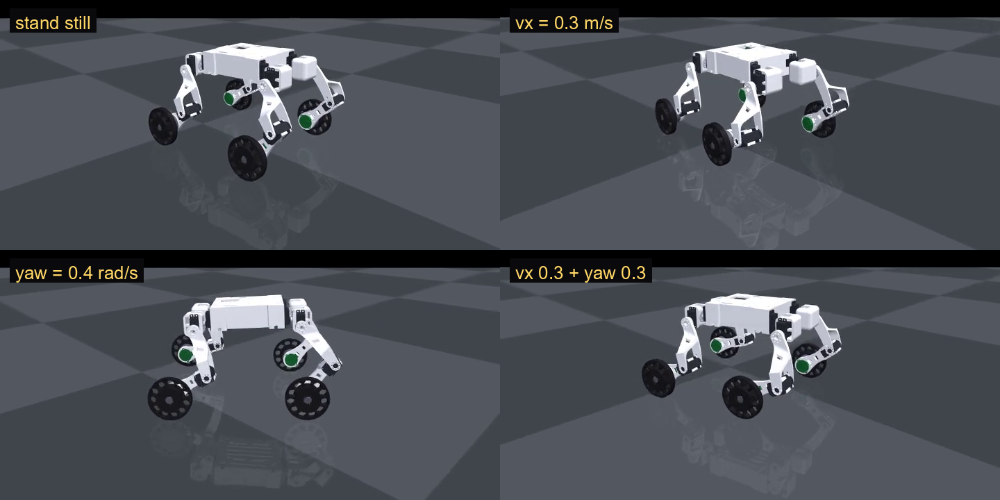
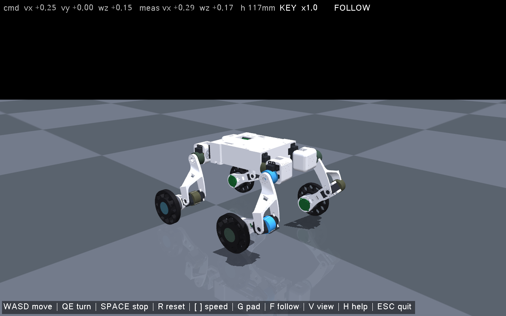

# w2l_12 · 12 自由度轮腿机器人

<p align="center">
  
</p>

把 SolidWorks 装配体 `w2l_12.SLDASM` 转成 MuJoCo 可直接加载的 MJCF，
再用 **MuJoCo + Gymnasium + stable-baselines3** 从零训一套轮腿运动策略，
导出 ONNX 后用键盘 / 手柄实时遥控 —— 速度指令接口 `(vx, vy, wz)` 已经留好，
后面接 SLAM / Nav2 只需要换指令源，策略不用重训。

<p>
  
  
  
  
  
</p>

---

## 演示

**遥控（键盘 WASD + 手柄）**：`cmd ±0.78 m/s`、`wz ±0.64 rad/s`，实测跟踪 `±0.5 m/s`：

<p align="center">
  
</p>

<p align="center">
  <a href="docs/demo.mp4">▶ 点击播放完整 18 s 视频（mp4，GitHub 不支持内嵌）</a>
</p>

**五种姿态**（站姿 / 蹲姿 / 伸展 / 外摆 / 不对称）：

<p align="center">
  
</p>

<details>
<summary>原始拼接图 preview_poses.png</summary>



</details>

**策略在仿真里的四种指令**（站住 / vx=0.3 m/s / 原地 yaw=0.4 rad/s / 边走边转）：

<p align="center">
  
</p>

---

## 目录

- [快速开始](#快速开始)
- [模型说明](#模型说明)
- [强化学习](#强化学习)
- [遥控窗口](#遥控窗口)
- [目录结构](#目录结构)
- [已知限制](#已知限制)
- [参考](#参考)

---

## 快速开始

```bat
:: 1) 看模型（滑块面板 + MuJoCo 窗口）
conda activate ms
cd /d D:\project\robot_leg\mujoco\w2l_12
python scripts\view_model.py

:: 2) 训练（需要 torch + stable-baselines3）
conda activate wheel_leg
python src\rl\prepare_assets.py                    :: 生成训练用轻量 MJCF
python src\rl\train_ppo.py --tag v1 --num-envs 16 --steps 12e6
python src\rl\export_onnx.py --tag v1              :: -> models\policy.onnx

:: 3) 遥控
conda activate ms
python scripts\remote_control.py
```

只用 MuJoCo 看模型：

```python
import mujoco, mujoco.viewer
m = mujoco.MjModel.from_xml_path(r"model\w2l_12.xml")
mujoco.viewer.launch(m)
```

## 模型说明

**坐标系**：`x` 向前、`y` 向左、`z` 向上，地面 `z = 0`，机身原点在底盘几何中心。
**前方是 −x**（`FL/FR` 在前、`RL/RR` 在后），默认站姿机身离地 **122.5 mm**。

**连杆**（18 个 body）：`base` + 4 × (`hip_*` 髋支架, `thigh_*` 大腿, `calf_*` 小腿, `wheel_*` 轮子)

```
base ──roll_FL── hip_FL ──hip_FL── thigh_FL ──knee_FL── calf_FL ──wheel_FL── wheel_FL
     └─roll_FR── ...                                   (FR / RL / RR 同构)
```

**关节**（16 个，全部 hinge，全部**力矩环**）：

| 关节 | 轴 | 0 度 | 正方向 | 范围 |
|------|----|------|--------|------|
| `roll_*` | `x`（左右镜像） | 腿竖直向下 | 外展 | −90° ~ 90° |
| `hip_*` | `y` | 大腿竖直向下 | 向 −x | −180° ~ 180° |
| `knee_*` | `y` | 小腿与大腿共线 | 向 −x | −135° ~ 135° |
| `wheel_*` | `y` | — | 绕轮轴 | 不限 |

侧摆轴在左右两侧取相反符号，所以 `roll = +20` 两侧都向外张，控制器可以左右共用一套参数。

**`qpos0` 语义**：几何按"机械零点（腿竖直伸直）"烘焙，`ref` 填站姿角度，于是

* `qpos = 0` → 机械零点（`<key name="zero">`）
* `qpos = ref` → 站姿 `roll 0° / hip −30° / knee +80°`（`<key name="stand">`，也是打开时的默认姿态）

用执行器时 `ctrl = 0` 表示"回机械零点"，要站住请用 `mj_resetDataKeyframe(m, d, 0)` 或把 `ctrl` 设成站姿角度。

**执行器**（`nu = 16`，力矩 / 电流模式，`ctrl` 就是关节力矩 N·m）：

| 执行器 | 类型 | 力矩限幅 | 说明 |
|--------|------|----------|------|
| `roll_*`、`hip_*`、`knee_*` | `motor` | **±0.98 N·m** | STS3032 堵转 10 kg·cm，力矩环直接给电流 |
| `wheel_*` | `motor` | **±0.29 N·m** | 2208：额定 0.06、峰值 0.29 N·m（3 A），KV 100 → 12 V 空载 ≈ 1200 rpm |

> 站姿下静态力矩需求很小（膝 0.15 N·m、髋 0.07 N·m、侧摆 0.08 N·m），
> 离 0.98 N·m 限幅还有 6 倍余量。
> 要位置伺服就自己算 `tau = kp*(q_des - q) - kd*qd` 写进 `ctrl`
> （`check_model.py` 的落地测试、`remote_control.py` 的力矩环都是这么做的）。
> 想要 XML 自带的位置 / 速度伺服版：`python src\create_model\build_model.py --actuators servo`。

**质量**（按零件体积 × 密度，电子件用实测/标称，总计 **1.255 kg**）：

| 部件 | 质量 | 说明 |
|------|------|------|
| `base`（底盘 + 上壳 + 电池 + 主板 + 4 个髋舵机 + 螺丝） | 0.456 kg | 电池 115 g、舵机 4×55 g |
| `hip_*` 髋支架 | 0.070 kg | |
| `thigh_*` 大腿 | 0.012 kg | |
| `calf_*` 小腿（含舵机 + 电机 + 编码器） | 0.102 kg | |
| `wheel_*` 轮子 | 0.016 kg | |

**碰撞体**：机身包围盒、大腿凸包、轮子圆柱（r = 30 mm，半宽 9 mm）。
视觉网格放在 `group=1`，碰撞体 `group=3`（默认不显示），
`contype/conaffinity` 只有碰撞体打开，视觉网格不参与接触计算。

## 转换流程

SolidWorks → MuJoCo 分三步，每一步都能单独重跑：

```bat
:: 1. 导出每个唯一零件的 STL + 所有实例位姿，并做质量校验
python src\create_model\export_cad.py --phase tree
python src\create_model\export_cad.py --phase parts

:: 2. 由配合特征（舵机轴 / 轴承 / 轮子同轴）推导 4 条腿的运动链
python src\create_model\derive_kinematics.py

:: 3. 生成 MJCF
python src\create_model\build_model.py
python src\create_model\build_model.py --thigh-deg 25 --calf-deg 45   :: 换站姿
python src\create_model\build_model.py --actuators servo             :: 位置/速度伺服版
```

`export_cad.py` 会打印自检：

```
[check] OK  mass 0.802871 vs 0.802871 kg | com err 0.000 mm  ([ 7.89 -36.27 45.23])
```

### 两个必须知道的坑

1. **`IComponent2::Transform2` 返回的是相对顶层装配体的绝对位姿，旋转按列主序存放。**
   16 个 double 里 `[0:9]` 是列主序旋转矩阵、`[9:12]` 是平移。按行主序读会把装配体读成"爆炸图"。
2. **这个装配体没有可用的配合（mates）。** 运动链是从几何特征推出来的：每个舵机的回转轴
   与它驱动连杆的轴承同轴（实测偏差 0.03 mm），轮子与小腿里的电机、编码器同轴（0.00 mm），
   膝轴就是小腿舵机的轴线。

## 自检

```bat
python src\create_model\check_model.py
```

当前结果：

* `qpos = 0` 时四条腿大腿方向都是 `(0, 0, −1)`，小腿与大腿夹角 **0.00°**；
* 站姿四条腿完全一致，四个轮胎中心高度差 **0.04 mm**，左右对称误差 **0.00 mm**；
* 轮距 149.8 mm（前后）× 180.8 mm（左右），机身离地 122.5 mm；
* 从站姿做 3 s 重力仿真（力矩模型 + 外部 PD）：下沉 **0.38 mm**、倾角 **0.14°**、最大穿透 **0.14 mm**。

---

## 强化学习

`src/rl/` 是一套完整的轮腿 PPO 链路，细节见 **[src/rl/README.md](src/rl/README.md)**。

### 观测 / 动作契约（53 → 16）

| 观测 | 维度 | 说明 |
|------|-----:|------|
| 角速度 | 3 | body 系，rad/s，×0.25 |
| 投影重力 | 3 | body 系，IMU 直接给 |
| 速度指令 | 3 | `(vx, vy, wz)` ← **SLAM / 遥控器从这接** |
| 腿部关节角 | 12 | 相对站姿，rad |
| 腿部关节速度 | 12 | rad/s，×0.05 |
| 轮子角速度 | 4 | rad/s，×0.05 |
| 上一步动作 | 16 | — |

**动作 16 维，导出的 `models/policy.onnx` 直接输出物理量**：

```
q_des[12] = 站姿[0, -30°, +80°] + a[0:12] * [0.125, 0.25, 0.25] rad   (侧摆/髋/膝)
w_des[4]  = a[12:16] * 25 rad/s
```

即 **12 个腿部目标角 (rad, 绝对角) + 4 个轮子目标角速度 (rad/s)**，
`action_scale`、默认站姿、关节限位都烘进了网络，下位机拿到 16 个数就能直接下发。
另有一份 `models/policy_norm.onnx` 输出归一化动作 `[-1,1]`，和训练逐位一致。

### 力矩环怎么接

策略给目标角，**舵机的力矩环负责跟**：

```c
tau = Kp * (q_des - q) - Kd * qd;     // 限幅 ±0.98 N·m
set_current(tau / Kt);
```

MuJoCo 里用 `<position kp=26 kv=1.6 forcerange="-0.98 0.98"/>` 是同一个东西（隐式积分更稳），
轮子用 `<velocity kv=0.7 forcerange="-0.29 0.29"/>` ↔ 真机速度环。
想直接出力矩：`prepare_assets.py --torque` + `train_ppo.py --torque`。

### 训练配置

| 项 | 值 |
|---|---|
| 仿真 | MuJoCo `dt = 0.002`（500 Hz）× decimation 10 → **50 Hz 策略** |
| 并行 | 16 进程（每进程只 import mujoco，不重复加载 torch） |
| 算法 | PPO，MLP 256-128-64，`n_steps 512`、`batch 1024`、`lr 3e-4` |
| 课程 | 指令范围 0.35 → 1.0 线性放大；`--cmd-vy` 可单独收缩 |
| 域随机化 | 摩擦 0.6~1.4、质量 0.9~1.15、质心 ±8 mm、Kp/Kd ±15%、动作延迟 0~2 步、观测噪声、3~7 s 推扰 |
| 训练量 | **12M 步 / 约 45 min**（~4.5k step/s） |

### 实测能力

| 指令 | 实测 | 说明 |
|------|------|------|
| `(0,0,0)` | vx ≈ 0，121 mm | 站着不动（20 s 位移 0.15 m） |
| `vx = 0.3` | 0.30 ~ 0.32 m/s | |
| `vx = 0.5` | 0.37 ~ 0.41 m/s | 摩擦 / 轮速到顶，实际最快约 0.45 |
| `wz = 0.4` | 0.39 ~ 0.40 rad/s | 原地转向 |
| `vy = 0.25` | ≈ 0 | **做不到**，见下 |
| ONNX 推理 | **0.013 ms** | 220 KB，占 20 ms 控制周期的 0.07% |

### 一个必须知道的机械限制

四条腿的轮轴**互相平行**，轮子只有滚动自由度。单独测纯差速轮速：

| 左右轮速差 | 偏航角速度 |
|---:|---:|
| ±3 rad/s | 0.05 rad/s |
| ±10 rad/s | 0.16 rad/s |
| ±15 rad/s | 0.22 rad/s |

**纯轮差速原地转向上限约 0.2 rad/s**（再大只是打滑 + 车身俯仰）。
策略能到 0.4 rad/s，是靠腿部姿态帮忙。所以：

* `vy` 横移物理上做不到 → **接 Nav2 时按差速车配**（`vy = 0`，靠 `wz` 转向）；
* 想转得更快：麦轮 / 全向轮、抬腿迈步转向、或者给轮子加转向舵机。

`deploy.yaml` 里部署上限给的是 `(0.55, 0.15, 0.45)`，训练课程上限是 `(0.6, 0.4, 1.0)`。

### 静止不溜车：部署层速度调节器

纯 RL 的 `exp(-|Δv|²)` 跟踪奖励在 `v≈0` 附近太平，压不住 4~6 cm/s 的残余漂移
（实测 20 s 走掉 1.3 m、偏航 68°）。**不用重训**，在部署层加一个轮速外环即可：

| 指标（20 s 站立） | 无调节器 | 有调节器 |
|---|---:|---:|
| 位移 | 1.28 m（还在走） | **0.15 m（2 s 后完全停住）** |
| 偏航 | 68° | **7°** |

符号是实测标定的（四轮同 `+Δ` → 机身朝 +x 走；左轮 `+Δ`/右轮 `−Δ` → 偏航变负），
代码在 `src/rl/robot_cfg.py::StandRegulator`。对比：`--no-reg`。

### 和参考实现的对照

| 项 | [RC_WheelLeg](https://github.com/zeitvex/RC_WheelLeg) | 本项目 |
|---|---|---|
| 观测 | 53 = 3+3+3+12+12+4+16 | **一致** |
| 动作 | 16 = 12 目标角 + 4 轮速 | **一致** |
| 控制频率 | 50 Hz | 50 Hz |
| 腿部伺服 | position Kp50 / Kd1.5 | position Kp26 / Kv1.6 |
| 轮部 | velocity Kd1.0 | velocity Kv0.7 |
| 动作缩放 | 0.125 / 0.25 / 5.0 | 0.125 / 0.25 / **25.0**（轮径 30 mm 重标定） |
| 地形 | 8 类课程 | 平地（`--slope-deg` 可加斜坡） |
| 部署 | ROS2/Nav2/ONNX/TensorRT | 键盘/手柄/串口/ONNX |

## 遥控窗口

`scripts/remote_control.py` 是唯一入口，自己写了一个 GLFW 窗口
（`mujoco.viewer` 会把 WASD 吃掉，相机也只能在它的小 UI 里拖）。

<p align="center">
  
</p>

| 输入 | 作用 |
|---|---|
| `W` `S` / `A` `D` | 前进后退 / 左右平移 |
| `Q` `E` | 左转 / 右转 |
| `SPACE` | 急停（指令清零） |
| `R` | 复位到站姿 |
| `[` `]` | 速度倍率 0.2x ~ 2.0x |
| `G` | 手柄 / 键盘切换 |
| `F` / `V` / `H` | 跟随相机 / 视角复位 / 帮助 |
| 鼠标 | 左键旋转、右键平移、滚轮缩放 |
| `ESC` | 退出 |

**接 SLAM 只需要换指令源**：

```python
cmd = np.array([vx, vy, wz])                                  # /cmd_vel
obs = build_obs(gyro, gravity, cmd, q_leg, qd_leg, wd_wheel, last_action)
action = policy(obs)                                          # ONNX / TensorRT
ctrl = action_to_ctrl(action)                                 # 12 目标角 + 4 轮速
```

`build_obs` / `action_to_ctrl` 在 `src/rl/robot_cfg.py`，训练和部署共用同一份。
`--serial COM3` 已经把 50 Hz 二进制帧实现好了（`0xAA55 + 12×f32 + 4×f32 + 校验和`）。

## 目录结构

```
w2l_12/
├─ model/
│  ├─ w2l_12.xml              力矩模型（16 个 motor）
│  └─ meshes/                 19 个零件 STL
├─ scripts/
│  ├─ view_model.py           交互式查看器（滑块 + MuJoCo 窗口）
│  └─ remote_control.py       ★ 遥控接口（键盘/手柄/串口/录像）
├─ src/
│  ├─ create_model/           导出 / 推导 / 生成 / 自检 / 渲染
│  └─ rl/                     训练链路（详见 src/rl/README.md）
│     ├─ robot_cfg.py         ★ 唯一契约：关节顺序 / 尺度 / PD / build_obs
│     ├─ w2l_env.py           Gymnasium 环境
│     ├─ train_ppo.py         PPO 训练
│     ├─ export_onnx.py       导出 12 目标角 + 4 轮速 的 ONNX
│     ├─ deploy.yaml          部署契约
│     ├─ models/policy.onnx   策略权重（220 KB）
│     └─ checkpoints/v1/      SB3 权重
├─ docs/                      预览图 / 演示视频
└─ README.md
```

## 已知限制

* **质量是估算的**：CAD 里零件密度是占位值，脚本按体积 × 典型密度、电子件按标称质量重算，
  惯量按网格积分。要做真正的动力学控制，建议用电子秤实测各连杆质量。
* 装配体里没有雷达 / 深度相机 / 香橙派，模型也只有 CAD 里有的零件。
* 碰撞体是简化的：机身包围盒、大腿凸包、轮胎圆柱；髋支架、小腿、舵机、螺丝不参与碰撞。
* 膝轴取自小腿舵机实测轴线，与髋轴有 ~3° 装配偏差，小腿转动平面与矢状面有极小的夹角。
* `vy` 横移做不到；原地转向受轮胎横向摩擦限制（见上文）。
* 训练只做了平地，粗糙地形 / 台阶还没上。

## 参考

* [legged_gym](https://github.com/leggedrobotics/legged_gym) / [rsl_rl](https://github.com/leggedrobotics/rsl_rl) — PPO + 指令课程 + 域随机化这套配方
* [RC_WheelLeg](https://github.com/zeitvex/RC_WheelLeg) — 16DOF 轮腿，mjlab + MuJoCo + ROS2/Nav2 全链路
* [Wheel-Legged-Gym](https://github.com/clearlab-sustech/Wheel-Legged-Gym) — 轮腿 legged_gym 变体
* [Wheel-Legged-Lab](https://github.com/zyicome/Wheel-Legged-Lab) — Isaac Lab 轮腿平衡/行走/跳跃
* [wheel_legged_genesis](https://github.com/Albusgive/wheel_legged_genesis) — Genesis + rsl_rl
* [mjlab](https://github.com/mujocolab/mjlab) — MuJoCo Warp + Isaac Lab 风格 API
* Lee et al., *Learning Robust Autonomous Navigation and Locomotion for Wheeled-Legged Robots*, **Science Robotics** 9(89), 2024 — [arXiv:2405.01792](https://arxiv.org/abs/2405.01792)
